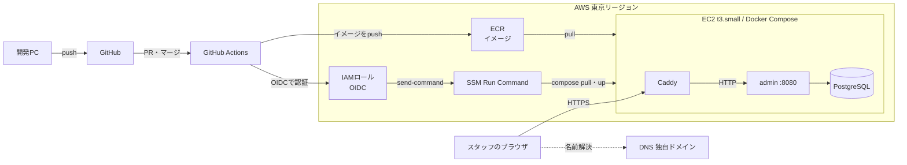

# 設計書:フェーズ0〜1(予約システム 1周目)

Oct 3, 2026 · @kenji

> 改訂(2026-10-25):`api`・`batch` で Flyway を止める方法を、設定(`spring.flyway.enabled=false`)から「依存を入れない」に変更。0-5 の実装に合わせた。理由は 4章「Flywayの方針」。
>
> 改訂(2026-10-24):名前の列の空文字をDBで弾く、`created_at`・`updated_at` はアプリが入れる(DEFAULT・トリガーなし)と決めた。理由は 4章「共通ルール」。
>
> 改訂(2026-10-19):DBアクセスを Doma 2 → MyBatis、開発環境を VS Code → IntelliJ IDEA、Java を 21 → 25 に変更。Backlog をやめたのでブランチ名の規則を変更。理由は 5章「技術の選定」と 6章「ブランチ運用」。

## 1. 範囲と前提

この設計書は WBS 0-1 の成果物で、フェーズ0(土台)とフェーズ1(管理画面と本番デプロイ)を実装するのに必要なことをすべて決める。フェーズ1の達成基準は「本番URLで管理画面にログインし、データを登録できる」。

| 章 | 対応するWBS |
| --- | --- |
| 2. 要件 / 3. 画面 | 1-1〜1-4、1-7 |
| 4. テーブル | 0-5、1-1、1-7 |
| 5. モジュール構成 | 0-2、0-3 |
| 6. 開発環境とCI | 0-4、0-6 |
| 7. インフラとデプロイ | 1-5、1-6 |
| 8. 苦手分野の地図 | 0-2〜0-6 全般 |

### 前提

- 題材のお店は「一人〜数人でやっている美容室・整体院のような、担当者を指名して予約する1店舗」とする。複数店舗は扱わない。
- 開発は個人PC(Windows 11)。JDK 25(21 も併存)/ Node 24 / Docker Desktop / IntelliJ IDEA は導入済み。
- 管理画面の利用者はスタッフ数人、データは数百〜数千件。性能より「正しく・安全に・直しやすく」を優先する。
- フェーズ1の重点テーマは「命名と責務分割」。設計もこの観点で、どこに何を書くかを先に決めておく。

### 着手前に済ませること

- [x] AWSのMFA(P-5)。このアカウントはBuilder IDでログインし、`AccountFullAccessRole` の一時的な権限で操作する新しい方式だった。ルートユーザーのパスワードでログインする入口はなく(root-onlyの操作は「Root access management」の特権セッションで行う)、ログインを守るのはBuilder IDのMFA。2026/10/4に登録済み。
- [x] 普段使いのユーザー作成(IAM Identity Center)は不要と判断。普段の操作がすでにルートではなくロール経由のため。

### 決めてほしいこと(0-2 までに)

- [x] Javaのパッケージ名:`io.github.kenjistudy.reservation` に決定(GitHubのユーザー名 Kenji-study から、小文字にしてハイフンを除いた形)。
- [x] 独自ドメイン:.com を買うことに決定。1-5 までにRoute 53で購入する(年$15前後+ホストゾーン月$0.50、AWSクレジットは使えない)。本番のHTTPS、フェーズ2のCloudFront、フェーズ3のメール送信元に使う。

## 2. 要件

フェーズ1で作るのは、スタッフが予約の「元データ」(メニュー・担当者・予約枠)を管理する画面。お客さんの予約そのものはフェーズ2で作る。

### 機能要件

| ID | 機能 | 内容 |
| --- | --- | --- |
| F-01 | ログイン・ログアウト | ログインID+パスワード。失敗時は「IDまたはパスワードが違います」とだけ出す(どちらが違うかは教えない) |
| F-02 | メニュー管理 | 一覧(検索・ページング)、登録、編集、削除。非公開にする機能を持つ |
| F-03 | 担当者管理 | 一覧(検索・ページング)、登録、編集、削除。在籍/退職を切り替えられる |
| F-04 | 予約枠管理 | 担当者×日付×開始〜終了時刻で枠を作る。一覧は日付範囲と担当者で絞り込む |
| F-05 | 権限による出し分け | 管理者とスタッフでメニュー表示と操作できる範囲が変わる |
| F-06 | 初期管理者の作成 | 本番の初回起動時、管理者が0人なら環境変数の値で管理者を1人作る |

### 権限

ロールは2つ。STAFF の「自分の枠だけ」は画面の出し分けだけでなく、URLを直接叩いても拒否されること(1-4 で確認する)。

| 操作 | ADMIN | STAFF |
| --- | --- | --- |
| メニューの閲覧 | ○ | ○ |
| メニューの登録・編集・削除 | ○ | ×(ボタン非表示、URL直打ちは403) |
| 担当者の閲覧 | ○ | ○ |
| 担当者の登録・編集・削除 | ○ | × |
| 予約枠の閲覧 | 全員分 | 全員分 |
| 予約枠の登録・編集・削除 | 全員分 | 自分に紐づく枠だけ |

アカウント管理画面はフェーズ1の対象外。ローカルでは開発用データでSTAFFアカウントを用意して確認する。

### 非機能要件

- **セキュリティ**:パスワードはBCryptでハッシュ化。CSRF対策を有効、セッションCookieは HttpOnly と Secure。本番はHTTPSのみ。
- **同時更新**:2人が同じデータを同時に編集したら、後から保存した人に「他の人が更新しました」と出す(楽観ロック)。
- **入力値**:サーバー側で必ず検証する。HTMLのrequired属性だけに頼らない。
- **一覧**:1ページ20件。100件以上のデータで操作できる(1-3 の完了条件)。
- **時刻**:お店の時刻はすべて日本時間(Asia/Tokyo)。サーバーのタイムゾーン設定に依存しない作りにする。
- **運用**:`/actuator/health` で死活確認できる。ログは標準出力に出す。

## 3. 画面とURL

画面は11、URLはリソースごとに同じ形にそろえる。メニューの形を一度作れば、担当者・予約枠は同じ型で作れる(1-7 が「1-1〜1-3と同じ水準」なのはこのため)。

### 画面一覧

| ID | 画面 | URL(GET) | 権限 |
| --- | --- | --- | --- |
| A-01 | ログイン | `/login` | 全員 |
| A-02 | トップ | `/` | ログイン済み |
| A-03 | メニュー一覧 | `/menus` | ログイン済み |
| A-04 | メニュー登録 | `/menus/new` | ADMIN |
| A-05 | メニュー編集 | `/menus/{id}/edit` | ADMIN |
| A-06 | 担当者一覧 | `/staff` | ログイン済み |
| A-07 | 担当者登録・編集 | `/staff/new`、`/staff/{id}/edit` | ADMIN |
| A-08 | 予約枠一覧 | `/slots` | ログイン済み |
| A-09 | 予約枠登録・編集 | `/slots/new`、`/slots/{id}/edit` | ADMIN、STAFF(自分の枠) |
| A-10 | エラー(403 / 404 / 500) | — | — |
| A-11 | 共通レイアウト(ヘッダー、ナビ、フラッシュメッセージ) | — | — |

### 更新系のURL(メニューの例)

| 操作 | メソッドとURL | 成功時 | 失敗時 |
| --- | --- | --- | --- |
| 登録 | `POST /menus` | `/menus` へリダイレクト、「登録しました」 | 同じ画面を入力値つきで再表示 |
| 更新 | `POST /menus/{id}` | `/menus` へリダイレクト、「更新しました」 | 同上。楽観ロック失敗は画面上部にメッセージ |
| 削除 | `POST /menus/{id}/delete` | `/menus` へリダイレクト、「削除しました」 | 参照されていて消せない場合はメッセージ |

- 更新系はすべて POST → リダイレクト → GET(PRGパターン)。ブラウザの再読み込みで二重登録しないため。
- HTMLフォームは GET と POST しか送れないので、PUT / DELETE は使わない。
- 削除はリンクではなくPOSTのボタン。GETで消えると、クローラーや先読みで消えるため。

### 画面ごとの仕様

**メニュー一覧(A-03)**:検索条件は名前(部分一致)と公開状態(すべて/公開/非公開)。並び順は表示順→ID。検索条件はクエリパラメータに載せ、ページを移っても条件が残ること。

**メニュー登録・編集(A-04、A-05)**

| 項目 | 必須 | ルール | エラーメッセージの例 |
| --- | --- | --- | --- |
| メニュー名 | ○ | 1〜50文字、前後の空白は除去 | メニュー名を入力してください |
| 説明 | — | 500文字以内 | 説明は500文字以内で入力してください |
| 所要時間(分) | ○ | 15〜480、15の倍数 | 所要時間は15分単位で入力してください |
| 料金(円、税込) | ○ | 0〜1,000,000の整数 | 料金は0以上の整数で入力してください |
| 表示順 | ○ | 0〜9999 | — |
| 公開 | — | チェックボックス、既定はオン | — |

**担当者一覧・登録(A-06、A-07)**:項目は氏名(1〜50文字)、表示順、在籍フラグ。一覧は氏名の部分一致と在籍状態で絞り込む。

**予約枠一覧(A-08)**:検索条件は日付の範囲(既定は今日から7日間)と担当者。並びは日付→開始時刻→担当者。

**予約枠登録・編集(A-09)**

| 項目 | 必須 | ルール |
| --- | --- | --- |
| 担当者 | ○ | 在籍中の担当者から選ぶ。STAFF は自分に固定 |
| 日付 | ○ | 今日以降 |
| 開始時刻・終了時刻 | ○ | 15分単位。終了は開始より後(項目をまたぐチェック) |

同じ担当者の枠が時間帯で重なったら「この時間帯には既に枠があります」で登録を拒否する。これは1項目のチェックでもアノテーションでもなく、DBを見ないと判断できない業務ルール。どの層に書くかはレビューで必ず見る。

## 4. テーブル設計

DBはPostgreSQL、テーブルは4つ。ログインする「アカウント」と、予約で指名される「担当者」は別テーブルにする。受付専任のスタッフや、ログインしないアルバイトの担当者が出てきても構造を変えずに済むため。

### 共通ルール

- 主キーは `id bigint generated always as identity`。
- 全テーブルに `created_at`、`updated_at`(どちらも `timestamptz not null`)と、楽観ロック用の `version integer not null default 0` を持つ。
- 業務上の制約(必須、範囲、一意)は画面のチェックだけでなくDBの制約でも守る。アプリのバグがあってもデータが壊れないようにするため。
  - 判断の基準は「どの入口(画面、API、バッチ、CSV取込、開発用データ、手で実行するSQL)から書き込まれても、あってはいけない状態か」。そうならDBで弾く。画面や用途によって変わるルールや、変わりやすい細かい数値はアプリ側で守る。
  - DBは「あってはいけない状態を弾く」だけにして、値を入れるのはアプリの仕事とする。
- 名前の列(`menu.name`、`staff.name`)は `not null` に加えて、空文字(`''`)もCHECK制約で弾く。`not null` はNULLしか弾かないため。名前が空のデータは、どのアプリから入っても意味をなさない。空白だけの値をどう扱うかは、画面側の前後の空白の扱いと合わせて決める。
- `created_at`、`updated_at` は `not null` だけを付け、DEFAULTもトリガーも付けない。値は必ずアプリが入れる。
  - 入れ忘れたときは `not null` 違反でINSERT・UPDATEが失敗するので、黙ってNULLが入ることはない。
  - DEFAULTを付けない理由は、時刻を入れる場所をアプリに一本化するため。アプリが時刻を入れれば、テストで時刻を固定できる(Javaの `Clock` を差し込む)。
  - トリガーを付けない理由は、MyBatisのSQLに書いていない値の変更が起きると読む人が気づけないことと、アプリが渡した値も上書きされるため。PostgreSQLのDEFAULTはINSERT時にしか効かず、MySQLの `ON UPDATE CURRENT_TIMESTAMP` に当たる仕組みもないので、DB側で更新日時を自動で入れるにはトリガーが必要になる。
  - INSERTのときは `created_at` と `updated_at` の両方に、同じ1つの時刻を入れる。「一度も更新されていない」を2つの値が等しいかで判定できるようにするため。`updated_at` を未更新の間NULLにする流儀は、`not null` を付けられず並び替えでNULLの扱いが増えるので採らない。
  - 開発用データ(`db/devdata`)のINSERTでも、2つの列に値を書く。
- 名前は複数形にしない(`menu`、`staff`)。列名はスネークケース。

### menu(メニュー)

| 列 | 型 | 制約 | 説明 |
| --- | --- | --- | --- |
| id | bigint | PK |  |
| name | varchar(50) | not null, check (空文字でない) | メニュー名 |
| description | varchar(500) |  | 説明 |
| duration\_minutes | integer | not null, check (15〜480) | 所要時間 |
| price | integer | not null, check (>= 0) | 税込の円 |
| display\_order | integer | not null default 0 | 表示順 |
| published | boolean | not null default true | 公開/非公開 |

### staff(担当者)

| 列 | 型 | 制約 | 説明 |
| --- | --- | --- | --- |
| id | bigint | PK |  |
| name | varchar(50) | not null, check (空文字でない) | 氏名 |
| display\_order | integer | not null default 0 | 表示順 |
| active | boolean | not null default true | 在籍中か |

### slot(予約枠)

| 列 | 型 | 制約 | 説明 |
| --- | --- | --- | --- |
| id | bigint | PK |  |
| staff\_id | bigint | not null, FK → staff | 担当者 |
| slot\_date | date | not null | お店の日付 |
| start\_time | time | not null | 開始 |
| end\_time | time | not null, check (end\_time > start\_time) | 終了 |

一意制約:`(staff_id, slot_date, start_time)`。日時を `timestamptz` ではなく日付と時刻に分けるのは、枠が「お店の壁掛け時計の時刻」であり、タイムゾーン変換の対象ではないため。日付での絞り込みも単純になる。

時間帯の重なりはこの一意制約では防げない(10:00〜11:00 と 10:30〜11:30)。フェーズ1はアプリ側で確認するだけにし、同時登録で重なる問題はフェーズ2の二重予約と一緒に扱う。

### account(ログインアカウント)

| 列 | 型 | 制約 | 説明 |
| --- | --- | --- | --- |
| id | bigint | PK |  |
| login\_id | varchar(50) | not null, unique | ログインID |
| password\_hash | varchar(100) | not null | BCryptのハッシュ |
| role | varchar(20) | not null, check (ADMIN / STAFF) | ロール |
| staff\_id | bigint | FK → staff, unique | STAFFが自分の枠を判定するのに使う。ADMINは空でよいが、STAFFは必須。CHECK制約「roleがSTAFFならstaff\_idはnot null」で守る |
| enabled | boolean | not null default true | 無効化したアカウントはログイン不可 |

担当者1人につきアカウントは0か1つ。2つ以上あると「自分の枠」がどのアカウントのものか決まらないため、`staff_id` に一意制約をかける。ADMINは `staff_id` が空なので、ADMINが何人いても一意制約にはかからない(PostgreSQLの一意制約は、標準の設定ではNULL同士を重複とみなさない)。アカウントを持たない担当者(ログインしないアルバイトなど)はそのまま作れる。

### 削除の方針

- 削除は物理削除。ただし「使わなくなった」場合は非公開・退職で対応する、と画面の文言で案内する。
- 予約枠がある担当者は削除できない。削除の前にコードで予約枠の有無を確かめ、あれば「予約枠があるため削除できません。退職にしてください」と表示する(メインの守り)。確かめた直後に別の人が枠を登録した場合などは外部キーで弾かれるので、その例外は「削除できませんでした」の汎用メッセージにする(保険)。この二段構えを作るのが 1-2 の練習になる。
- フェーズ2で予約テーブルがメニューと枠を参照すると、使われたメニューや枠も消せなくなる。それで正しい(過去の予約の記録が壊れない)。

### Flywayの方針

- マイグレーションは `core` モジュールの `src/main/resources/db/migration` に置く。ファイル名は `V1__create_menu.sql` のように、番号+内容。
- 一度pushしたマイグレーションは書き換えない。直したいときは新しい番号で `alter` を書く。
- 開発用データ(STAFFアカウント、メニュー100件など)は本番に入らない別の場所 `db/devdata` に置き、`local` プロファイルのときだけ読み込む。
- マイグレーションを実行するのは `admin` アプリだけにする。`api` と `batch` には Flyway の依存(`spring-boot-starter-flyway`・`flyway-database-postgresql`)を入れない。3つが同時に起動して同時にマイグレーションするのを避けるため。依存がなければ Flyway の自動設定が動かないので、`spring.flyway.enabled=false` の設定より確実で、設定のし忘れも起きない。マイグレーションのSQL自体は `core` に置き、`admin` が `core` に依存することで読み込む。ただしこれは本番に出るのがadminだけのフェーズ1の暫定で、テーブルの変更がadminのデプロイに依存する弱点がある。見直しはフェーズ2(9章)。
- テーブルを作るのはFlywayだけ。MyBatisはSQLを実行するだけで、テーブルの定義は持たない。

## 5. モジュール構成とリポジトリ

依存の向きは一方通行で、`api`・`admin`・`batch` が `core` に依存し、`core` はどこにも依存しない。`admin` から `api` を使うような横の依存は禁止。

### 技術の選定

| 項目 | 選定 | 理由 |
| --- | --- | --- |
| Spring Boot | Initializr で選べる最新の安定版(4.x) | 新規案件は最新版で始めるのが普通。SNAPSHOT / M版は選ばない |
| ビルド | Gradle(Groovy DSL)+ Gradle Wrapper + バージョンカタログ | 0-3 で Groovy DSL で作ったのでそのまま(Kotlin DSL は2周目以降)。バージョンは `gradle/libs.versions.toml` に集約 |
| DBアクセス | MyBatis(Spring Boot と連携する mybatis-spring-boot-starter。Spring Boot 4 に対応した版を 0-5 で公式から確かめて入れる) | SQLを自分で書いてSQLの力をつけるため。日本の案件で最も多く使われている方式の一つ(2026-10-19 に Doma 2 から変更)。SQLとJavaのずれは実行時に分かるので、Mapper ごとに小さなテストを書いて早めに気づく。JPAは2周目以降で触る |
| DB | PostgreSQL(Docker公式イメージの最新メジャー) | 無料で、AWSのRDSにもそのまま移せる |
| 画面 | Thymeleaf + Spring MVC | 計画どおり |
| 認証 | Spring Security(フォームログイン、セッション) | 計画どおり |
| CSS | 素のCSSか、CDNなしで同梱する軽いCSS 1つ | 見た目は今回の学習対象外。凝らない |

### モジュールの責務

| モジュール | プラグイン | 置くもの | 置かないもの |
| --- | --- | --- | --- |
| core | java-library | エンティティ、Mapper(インターフェースとSQLのXML)、業務ルール(枠の重なり判定など)、Flywayのマイグレーション | Controller、画面用のForm、HTTPやセッションの知識 |
| admin | Spring Boot | Controller、Form、画面テンプレート、セキュリティ設定、画面向けのサービス | 業務ルールそのもの |
| api | Spring Boot | フェーズ0は起動するだけ。フェーズ2でREST API | — |
| batch | Spring Boot | フェーズ0は起動するだけ。フェーズ3でジョブ | — |

`core` に Spring Boot プラグインを付けると実行用のjarを作ろうとして失敗する。ライブラリとして作る、という区別が 0-3 の最初のつまずきどころ。もう一つ、MyBatisの Mapper の XML をどこに置き、Spring Boot にどう見つけてもらうか(Mapper インターフェースの登録と XML の置き場所の設定)。これが二つ目のつまずきどころ。

### パッケージ

機能ごとに切る(package by feature)。層ごと(`controller` / `service` / `repository`)に切ると、メニューの修正で4つのパッケージを行き来することになるため。

```
core:   io.github.kenjistudy.reservation.menu   … Menu, MenuMapper(+ SQLのXML)
        io.github.kenjistudy.reservation.slot   … Slot, SlotMapper, SlotOverlapChecker(仮)
admin:  io.github.kenjistudy.reservation.admin.menu … MenuController, MenuForm, MenuAdminService
        io.github.kenjistudy.reservation.admin.security … SecurityConfig ほか
```

クラス名は例。名前で何をするか分かるか、Controllerに業務ロジックが漏れていないかが、フェーズ1のレビューの中心になる。

### リポジトリの構成

```
reservation/
├─ CLAUDE.md
├─ README.md
├─ settings.gradle          … core, api, admin, batch を include
├─ build.gradle             … 全モジュール共通の設定
├─ gradle/libs.versions.toml
├─ gradlew, gradlew.bat, gradle/wrapper/
├─ .gitattributes, .gitignore, .editorconfig
├─ core/  api/  admin/  batch/
├─ frontend/                … フェーズ2で作成。Gradleの管理外(npm)
├─ compose.yaml             … ローカル開発用(DBだけ)
├─ deploy/                  … 本番用 compose.prod.yaml、Caddyfile
├─ docs/                    … この設計書、運用手順書
└─ .github/workflows/       … ci.yml、deploy.yml
```

`frontend` は計画書では「マルチモジュール」の一つだが、Gradleのモジュールにはせず、同じリポジトリの別フォルダとして置く。

## 6. 開発環境とCI

ローカルではDBだけをDocker Composeで動かし、アプリはIntelliJ IDEAか `gradlew` から直接起動する。アプリまでコンテナにすると、コードを変えるたびにイメージを作り直すことになり遅いため。

### ローカル開発

| 項目 | 決めごと |
| --- | --- |
| DB | `compose.yaml` に postgres を1つ。データはnamed volumeに保存。ポートは 5432 |
| 接続情報 | ローカル用の値は `application-local.yml` に書いてよい。本番の値はリポジトリに入れない |
| プロファイル | `local`(開発)と `prod`(本番)の2つ。起動時に `local` を指定する |
| 開発用データ | `local` のときだけ `db/devdata` を読み込み、ADMIN・STAFFのアカウントとメニュー100件以上を入れる |
| ポート | admin 8080、api 8081、batch はWebなし |

### ブランチ運用

GitHub Flowにする。`main` は常に本番と同じ状態で、作業はブランチを切ってプルリクエスト(PR)でマージする。

- ブランチ名はWBSの番号+内容(形は `feature/<WBS番号>-<内容>`。中身は課題ごとに自分で考える)。WBSとコードが後から対応づく。
- `main` へは直接pushしない。GitHubのブランチ保護で「CIが通らないとマージできない」を設定する。
- PRは1課題1つ。大きくなったら分ける。PRの説明にWBSの番号と完了条件を書く。
- マージ方法は「Squash and merge」に統一し、`main` の履歴を1PR=1コミットにする。

### CI(ci.yml)

| 項目 | 決めごと |
| --- | --- |
| きっかけ | PRの作成・更新時と、`main` へのpush時 |
| 環境 | ubuntu-latest、Temurin 25 |
| やること | `./gradlew build`(コンパイル+テスト+jar作成)。Gradleのキャッシュを効かせる |
| DB | フェーズ0〜3はGitHub Actionsのサービスコンテナで postgres を起動する。フェーズ4でTestcontainersに置き換える |
| 結果 | 失敗したらPRにバツが付き、マージできない |

フェーズ0の時点のテストは「アプリが起動すること」を確かめる1本だけでよい。それでもDBに接続しに行くので、CIにDBが必要になる。ここが 0-6 で一番詰まりやすい所。

## 7. インフラ構成とデプロイ

本番はEC2一台にDocker ComposeでCaddy・admin・PostgreSQLを載せ、GitHub ActionsからSSHを使わずにデプロイする。AWSのアクセスキーもSSHの秘密鍵も、GitHubには一つも保存しない。



上の段が開発の流れ、点線の中がAWS。ActionsはOIDCで一時的な権限を借り、イメージをECRに置いてから、SSM経由でEC2に「新しいイメージで起動し直せ」と命令する。

### 構成要素

| 要素 | 決めごと | 理由 |
| --- | --- | --- |
| EC2 | t3.small(メモリ2GB)、Amazon Linux 2023、東京リージョン、Elastic IPで固定 | 1GBのt3.microでJavaとPostgreSQLを同居させるとメモリ不足になりやすい |
| セキュリティグループ | 80と443だけ開ける。22は開けない | サーバーへの操作はSession Managerで行い、SSHの口をなくす |
| Caddy | リバースプロキシ。Let's Encryptの証明書を自動で取得・更新 | nginx+certbotより設定が数行で済み、更新忘れがない |
| ECR | リポジトリは `admin` の1つ。最新10個だけ残すライフサイクルルール | EC2はインスタンスロールでpullでき、認証情報を置かずに済む |
| GitHub → AWS の認証 | OIDCでIAMロールを借りる。信頼条件で自分のリポジトリの `main` だけに限定 | 長期のアクセスキーは漏れたら終わり。OIDCは1回のジョブの間だけ有効 |
| 秘密情報 | EC2上の `.env`(DBパスワード、初期管理者パスワード)、権限600 | リポジトリには絶対に入れない。管理の改善はフェーズ4 |
| DBのデータ | PostgreSQLのnamed volume(EBS上) | コンテナを作り直してもデータが残る |

### デプロイの流れ(deploy.yml)

1. `main` へのマージで起動する(CIが通ったコミットしかマージできないので、壊れたものは来ない)
2. jarをビルドしてDockerイメージを作り、タグにコミットSHAを付ける
3. OIDCでIAMロールを借り、ECRへpushする
4. SSM Run CommandでEC2に「使うタグを書き換えて compose pull → up -d」を実行させる
5. `/actuator/health` がUPになるまで待ち、ならなければジョブを失敗させる

**戻し方**:手動実行(workflow\_dispatch)で前のコミットSHAを指定し、4〜5だけを動かす。イメージはECRに残っているので作り直さない。ただしFlywayは戻らないので、マイグレーションは「1つ前のアプリでも動く」形で足していく(列の追加はよいが、いきなり列名の変更や削除はしない)。

### 費用の目安(概算、要確認)

t3.smallを24時間動かすと月20ドル前後、パブリックIPv4が月3〜4ドル、ECRとEBSは数ドル以下の見込み。クレジット$100で無料プランの期限(2027/4/3)までは足りる計算だが、月$10の予算アラートは超えるので、1-5 の前に「閾値を上げる」か「使わない日は停止する」かを決める。期限後もこの環境を使うなら、それまでに有料プランへの切り替えが必要。正確な金額はAWSの料金計算ツールで確認すること。

## 8. 苦手分野の地図

3つとも「全部覚える」必要はない。フェーズ0〜1で使うのは下の範囲だけで、これ以外が必要になったらその都度聞けばよい。

### Git:毎回この順番

1. `main` を最新にする(pull)
2. 課題用のブランチを作って切り替える
3. 作業して、意味のある単位でコミットする(add → commit)
4. GitHubへpushし、PRを作る
5. CIが緑になったらSquash and merge、ローカルの `main` に戻ってpull

困ったときは、まず `git status` を見る。今どのブランチにいて、何が変更されているかが分かれば、たいていの迷子は解決する。コミット前の変更を消す系のコマンドは、実行前に一度聞いてほしい。

### Gradle:使うのは5つ

| やりたいこと | 形 |
| --- | --- |
| 全部ビルドしてテスト | `gradlew build` |
| テストだけ | `gradlew test` |
| 1つのモジュールだけ | 先頭に `:モジュール名:` を付ける(例:`:admin:test`) |
| アプリを起動 | `:admin:bootRun`(プロファイルの渡し方は自分で調べてみる) |
| 依存ライブラリの一覧 | `:admin:dependencies` |

- 必ずリポジトリに入っている Wrapper(`gradlew` / `gradlew.bat`)を使う。PCに入れたGradleは使わない。全員が同じバージョンでビルドするため。
- Windowsのターミナルでは `gradlew.bat`、CI(Linux)では `./gradlew`。
- 「ビルドがおかしい」と思ったら、エラーの最初の数行と `What went wrong` の部分を読む。最後の行だけ見ても原因は書いていない。

### GitHub Actions:3つの言葉だけ

- **workflow**:`.github/workflows/` のYAMLファイル1つ。「いつ動くか(on)」と「何をするか(jobs)」を書く。
- **job**:1台の使い捨てマシンで動く作業のまとまり。job同士は別マシンなので、ファイルは共有されない。
- **step**:jobの中の1手順。既製の部品(`uses`)か、コマンド(`run`)のどちらか。

失敗したら、GitHubのActionsタブで赤いstepを開き、そのログを読む。ローカルで同じコマンド(`gradlew build`)が通るかを先に確かめると、原因がコードかCI設定かを切り分けられる。

### Windowsの落とし穴

- **改行コード**:WindowsはCRLF、LinuxはLF。`gradlew` がCRLFになるとCIで動かない。`.gitattributes` で `gradlew` やシェルスクリプトをLFに固定する。
- **実行権限**:Windowsで作った `gradlew` には実行権限が付かず、CIで「Permission denied」になる。Gitに実行権限を記録させる方法がある。0-6で出たら、エラー文で検索するところから始めてほしい。
- **パスの長さと日本語**:リポジトリは `C:\dev\reservation` のような短く、日本語と空白のない場所に置く。
- **Docker Desktop**:起動していないと `compose up` が失敗する。WSL 2のバックエンドで動いていることを確認する。

## 9. フェーズ2以降に持ち越すこと

フェーズ1では意図的に次のことをやらない。やらない理由が分かっていること自体が、口頭試問(1-9)の確認対象になる。

| 項目 | フェーズ1の扱い | どこで扱うか |
| --- | --- | --- |
| 予約枠の同時登録による重なり | アプリ側の確認のみ。同時に押されたら重なりうる | フェーズ2(二重予約の防止と一緒に) |
| マイグレーションの実行 | adminアプリが起動時に流す(本番に出るのがadminだけのための暫定)。テーブルの変更がadminのデプロイに依存してしまう | フェーズ2(apiを本番に出すとき)。アプリから切り離し、デプロイ手順の独立したステップにするかを決める |
| アカウント管理画面 | 作らない。ローカルは開発用データ、本番はADMINのみ | 必要になった時点で追加 |
| DBのバックアップ | 自動化しない。EBSスナップショットを手動で取れるようにしておく | フェーズ4(運用) |
| 秘密情報の管理 | EC2上の `.env`(権限600) | フェーズ4でSSM Parameter Storeを検討 |
| ログの集約と監視 | `docker logs` で見る。ヘルスチェックのみ | フェーズ4(CloudWatch) |
| ステージング環境 | 作らない。PRのCIとローカル確認で代える | 2周目以降 |
| ECS Fargate + RDS への移行 | やらない(計画書どおり) | 2周目以降 |
